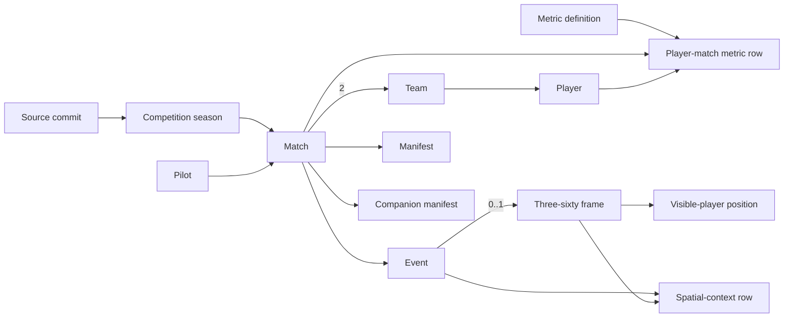
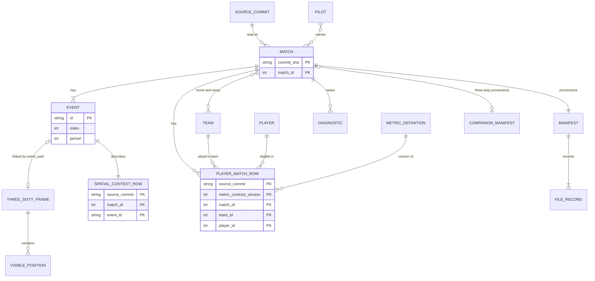

# Data model

The project's data at three levels: conceptual (what the things are),
logical (their attributes, keys, and relations, without storage), and
physical (how each is stored today). Everything here is taken from the
code, the provider documents read for the project, and the other
documents; where something is unclear it says so. Field meanings are in
[provider semantics](provider_semantics.md), the metric contract in the
[metric catalog](metric_catalog.md), and storage details in the
documents linked below; they are not repeated here.

## 1. Conceptual model

The project reads StatsBomb Open Data at one **source commit** (a pinned
version of the upstream repository). At that commit a **competition
season** has a match list, and each **match** has an events file, a
lineups file, and, for some matches, a three-sixty file.

- A **match** is played by two **teams**. **Players** belong to a team
  in a match.
- An **event** is one recorded action of a match: a type, a time, often
  a team, a player, and a location. Some events carry flags such as
  `counterpress`.
- A **three-sixty frame** belongs to at most one event, and holds the
  **visible-player positions** at that event's moment: anonymous
  entries, except the one marked as the event's actor.
- A **metric definition** (in the metric catalog, under a contract
  version) turns a match's events into one **player-match metric row**
  per eligible player of the match.
- A **spatial-context row** describes, for one event, the visible
  players around its actor in that event's frame.
- A **pilot** names a fixed list of matches and combines their
  player-match rows into one table.
- A **manifest** records, for one match, where each source file came
  from and its fingerprint; a **companion manifest** does the same for
  the match's three-sixty file.

### In the source but not modelled

These exist in the source files but have no entity of their own in the
project. They are stored only as part of the raw files, and some are
counted by the profiler.

| In the source | What the project does with it |
|---|---|
| Competitions and seasons (`competitions.json`) | Stored raw. Only the ids and names copied into a manifest's `match_metadata` are used |
| The match-list record beyond identity, stage, date, and score | Stored raw; other fields are not used |
| Lineups: jersey number, country, nickname, cards, position intervals | Stored raw and profiled ([schema profile](schema_profile.md)). Metric eligibility uses `Starting XI` and `Substitution` events instead, and the dashboard's player list uses `tactics.lineup` on events |
| Possession, play pattern, related events, event durations | Present on events; profiled; not used by any metric |
| Shot freeze frames (`shot.freeze_frame`) | Present on shot events; not modelled |
| Camera view (`visible_area`) of a three-sixty frame | Drawn by the dashboard on request and summarised as a status in the spatial context; not stored as geometry |
| Minutes played | Not in the source as a value. The rules to derive it are not documented ([schema profile](schema_profile.md), "Prerequisites for minutes played") |
| Tracking data | Not in the source and not in the project |

## 2. Logical model

Keys are logical: they are what the code treats as identity, not
database constraints. `c` is the source commit SHA and `m` the match id.

| Entity | Attributes (main) | Key | Relations |
|---|---|---|---|
| Source commit | `commit_sha`, repository URL | `commit_sha` | 1:N matches read at it |
| Match | `match_id`, competition and season ids and names, date, stage, home and away team ids and names, scores | `(c, m)` | N:1 commit; 1:2 teams; 1:N events; 1:N player-match rows; 1:1 manifest; 1:0..1 companion manifest |
| Team | `team_id`, `team_name` (a label) | `team_id` | N:M matches (two per match) |
| Player | `player_id`, `player_name` (a label) | `player_id` | N:M teams and matches through player-match rows |
| Event | `id`, `index`, `period`, `timestamp`, `minute`, `second`, `type`, `team`, `player`, `location`, flags such as `counterpress` | `(c, m, id)` | N:1 match; N:0..1 team and player; 1:0..1 frame |
| Three-sixty frame | `event_uuid`, `visible_area`, `freeze_frame` | `(c, m, event_uuid)` | 0..1:1 event (`event_uuid` = event `id`) |
| Visible-player position | `location`, `teammate`, `actor`, `keeper` | None that identifies a player: only the frame and the entry's place in its list | N:1 frame |
| Metric definition | `metric_name`, classification, contract version, formula | `(metric_name, contract version)` | Defines one column of the player-match row |
| Player-match metric row | the three counts, team and player names | `(c, contract version, m, team_id, player_id)` | N:1 match, team, player |
| Diagnostic | name, count, event ids | `(c, m, name)` | N:1 match; references events |
| Spatial-context row | event identity and location, actor position, visible counts, nearest opponent, radius counts, statuses | `(c, m, event_id)` | 1:1 event |
| Pilot | name, commit, competition, season, match ids, selection rule | `name` | N:M matches |
| Manifest / file record | source path, URL, local path, SHA-256, size, retrieval time | manifest: `(c, m)`; file record: `source_path` within it | 1:N file records; a shared file is recorded in several manifests |

A visible-player position has no key that names a player: apart from
the actor, entries are anonymous, and their order in a frame must not be
read as an identity (see [three-sixty frames](three_sixty.md)).

Unclear, and not relied on:

- Whether an event `id` is unique across matches. The code checks
  uniqueness within one events file only, and every key above includes
  the match. Observed in the fifteen pilot matches; not guaranteed by the
  provider documents in the repo: none of the 59,192 event ids occurs in
  more than one match's events file.
- Whether a `player_id` names the same person in every match. The
  project never merges rows across matches, so it does not depend on it.
  Observed in the fifteen pilot matches; not guaranteed by the provider
  documents in the repo: in the events files (`player`,
  `tactics.lineup[].player`, `substitution.replacement`), none of the
  279 player ids appears with two different names and no name with two
  different ids; the same holds for the 405 player ids of the lineups
  files, and each of the 279 event ids is in the lineups with the same
  name.
  120 of these ids have events in more than one match. Equal ids and
  names do not prove that they denote one person.

## 3. Physical model

Everything is files. Raw and derived data are partitioned by commit and
match in folder names; the commit and match are repeated as columns in
every derived row. Data under `data/` is not in Git; manifests and pilot
definitions are.

| What | Path pattern | Format | In Git |
|---|---|---|---|
| Raw source files | `data/raw/statsbomb/open-data/<c>/data/` then `competitions.json`, `matches/<competition>/<season>.json`, `events/<m>.json`, `lineups/<m>.json`, `three-sixty/<m>.json` | JSON arrays, byte-for-byte copies | No |
| Match manifest | `manifests/statsbomb/open-data/<c>/match_<m>.json` | JSON, format version 1 | Yes |
| Companion manifest | `manifests/statsbomb/open-data/<c>/match_<m>.three_sixty.json` | JSON, format version 1 | Yes |
| Pilot definition | `pilots/<name>.json` | JSON, pilot format version 1 | Yes |
| Profile | `data/processed/profiles/<c>/<m>/` | `summary.json`, `event_types.csv`, `field_presence.csv`, `quality_findings.json` | No |
| Metrics | `data/processed/metrics/<c>/<m>/` | `player_match_metrics.csv`, `diagnostics.json`, `run_summary.json` | No |
| Per-match analytical table | `data/processed/analytics/<c>/<m>/` | `player_match_metrics.parquet`, `build_metadata.json` (version 2) | No |
| Pilot combined table | `data/processed/analytics/<c>/pilots/<name>/` | `player_match_metrics.parquet`, `build_metadata.json` (combined version 1) | No |
| Three-sixty report | `data/processed/three_sixty/<c>/<m>/` | `summary.json`, `coverage.csv` | No |
| Spatial context | `data/processed/three_sixty/<c>/<m>/` | `spatial_context.csv`, `spatial_context_summary.json` | No |

Formats and checks: [manifests](../manifests/README.md),
[analytical layer](analytical_layer.md), [metric catalog](metric_catalog.md)
("Implementation and outputs", "Exploratory event-level indicators"),
[three-sixty frames](three_sixty.md).

### Player-match table

| Column | Parquet type | CSV | Null |
|---|---|---|---|
| `source_commit` | VARCHAR | yes | never |
| `metric_contract_version` | BIGINT | no (taken from `run_summary.json`) | never |
| `match_id` | BIGINT | yes | never |
| `team_id` | BIGINT | yes | never |
| `team_name` | VARCHAR | yes | never |
| `player_id` | BIGINT | yes | never |
| `player_name` | VARCHAR | yes | never |
| `pressure_event_count` | BIGINT | yes | never |
| `counterpress_pressure_event_count` | BIGINT | yes | never |
| `counterpress_flagged_event_count` | BIGINT | yes | never |

- Types are declared in `analytics.py`, not inferred, and every column
  is `NOT NULL`. Compression: snappy.
- Composite key: `source_commit`, `metric_contract_version`,
  `match_id`, `team_id`, `player_id`. The Parquet rows are sorted by it;
  the CSV rows by `team_id`, then `player_id`. Neither order is a
  ranking.
- The pilot combined table has the same columns and key; it holds the
  rows of every pilot match.

### Spatial-context table

One row per source event, in events-file order. Its 35 columns (with
the default radii 5, 10, and 20) are listed by
`three_sixty.context_columns()` and defined in the metric catalog. The
CSV carries no types: a null is an empty field, booleans are written
`true` and `false`. Indicators are null when not computed and 0 only
when computed.

### Stored nowhere as a table

- Events and three-sixty frames: read from the raw JSON, verified
  against their manifest, and parsed in memory each time.
- Visible-player positions: used in memory for the spatial context and
  the dashboard's pitch; only per-event counts and distances are
  written.
- Teams, players, and match facts: there is no separate table. Match
  facts are read from the verified match list when needed.

## Where the physical model differs from the logical one, and why

| Difference | Why |
|---|---|
| Team and player names are repeated on every row as labels; there are no team or player tables | Names are display labels, never keys; ids are the keys. `team_name` is taken from the team's `Starting XI` event and `player_name` from the first record that makes the pair eligible ([metric catalog](metric_catalog.md)) |
| No match, team, or player dimension tables | Every derived table is for one match or one pilot, and match facts come from the verified source each time instead of a second copy |
| Events and frames stay as raw JSON | The raw layer is the single source; derived data must be rebuildable from it, and only the outputs the project needs are written |
| Visible-player positions are not stored | Entries carry no identity, and the project derives only per-event context from them |
| Commit and match are both folder names and columns | Folders keep every revision and match apart; the columns let a row be checked against its folder |
| `metric_contract_version` is in Parquet but not in the CSV | The CSV's contract version is in its `run_summary.json`; the analytical layer copies it into each row |
| The pilot table copies the per-match rows | It is checked against each match's build metadata and checksums at combine and query time |
| A shared source file is recorded in several manifests | Each manifest is complete for its own match; the records must agree |
| No persistent database | The largest table has 468 rows; DuckDB reads the Parquet files in memory, and a `.duckdb` file would be a second copy to keep in step ([analytical layer](analytical_layer.md)) |
